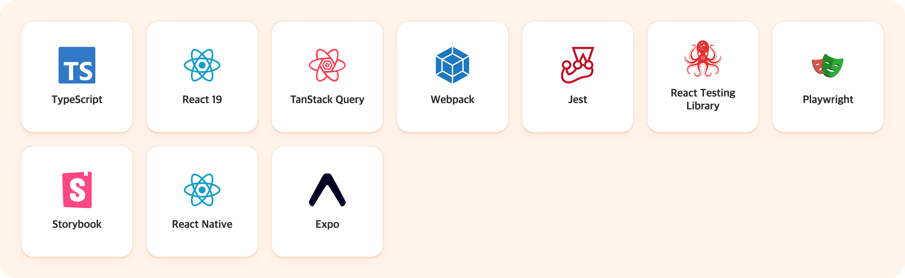
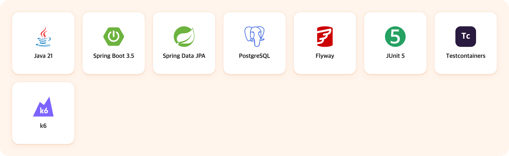
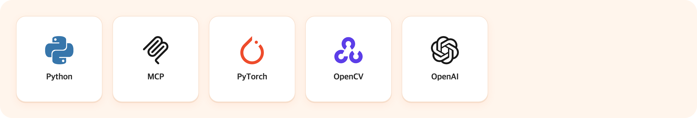
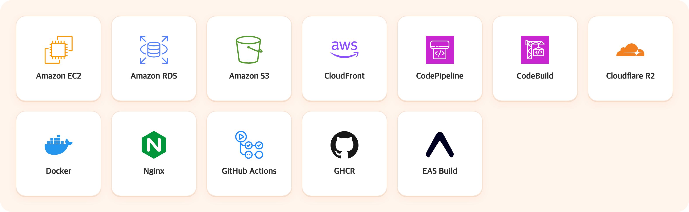
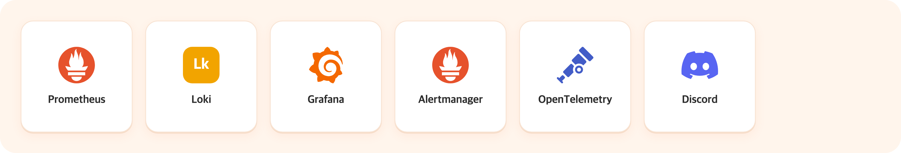
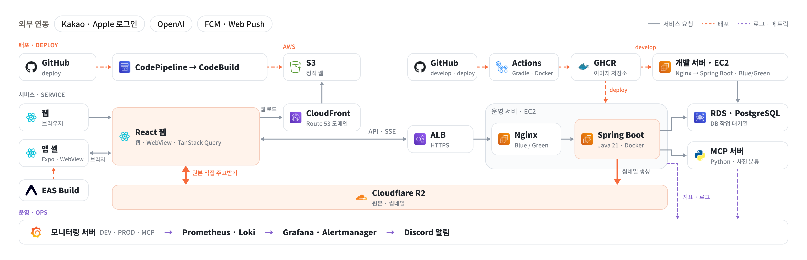
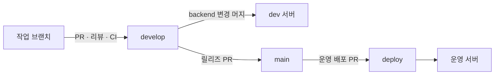

  

  # 쏙 sssOK

  ### 사진 보내달라는 말, 이제 그만!

  링크 하나로 다 같이 모으고, 내 사진만 원본 그대로 쏙 받아 가요.

  
  

## 서비스 소개

<h3 align="left">모임이 끝나면 꼭 나오는 말, “사진 좀 보내 줘~”</h3>

<b>쏙</b>은 링크 하나로 다 같이 찍은 사진을 <b>원본 그대로</b> 한곳에 모으는 사진 공유 서비스예요.

| 단톡방에서는 | 쏙에서는 |
| :--- | :--- |
| 용량 때문에 나눠서 보내고 | **링크 하나**에 다 같이 올려요 |
| 받고 보니 화질은 깨져 있고 | **원본 그대로** 한 번에 저장해요 |
| 여러 사진 중에 내가 나온 사진은 찾기 힘들고 | **내 사진만** 골라 받아요 |
| 다른 앱으로 옮기려면 설치·가입부터 하고 | **앱·가입 없이** 링크만 누르면 들어와요 |

### 이렇게 써요

<table>
  <tr>
    <td width="50%"><b>① 링크 만들기</b> 쏙에서 방 하나 만들고 단톡방에 링크만 올려요.</td>
    <td width="50%"><b>② 다 같이 올리기</b> 각자 찍은 사진이 한곳에 쏙! 따로 보내 달라고 안 해도 돼요.</td>
  </tr>
  <tr>
    <td></td>
    <td></td>
  </tr>
  <tr>
    <td><b>③ 원본으로 받기</b> 카톡처럼 깨지지 않게, 다 모이면 원본 그대로 한 번에 저장해요.</td>
    <td><b>④ 내 사진만 받기</b> AI가 사람별로 사진을 나눠 줘서, 버튼 한 번으로 내가 나온 사진만 받아요.</td>
  </tr>
  <tr>
    <td></td>
    <td></td>
  </tr>
</table>

<b>다음 모임엔 “사진 보내 줘” 대신, 링크 하나만 보내 봐요!</b>

## 기술 스택

### Frontend & App (iOS · Android)

### Backend

### AI · 사진 분류

### Infrastructure & CI/CD

### Monitoring

## 아키텍처

| 배포 대상 | 흐름 |
| :--- | :--- |
| 웹 | `deploy` → CodePipeline → CodeBuild → S3 → CloudFront |
| 백엔드 | `develop`·`deploy` → GitHub Actions → GHCR 이미지 → EC2 (Nginx Blue/Green 무중단 전환) |
| 사진 분류 MCP | GitHub Actions 수동 실행 → GHCR 이미지 → MCP 전용 EC2 |
| 모니터링 서버 | GitHub Actions 수동 실행 → 중앙 모니터링 EC2 |
| 앱 | EAS Build → iOS: App Store · Android: APK·App Bundle 빌드 |

## 프로젝트 구조

| 폴더 | 내용 |
| :--- | :--- |
| [frontend](frontend/) | React 웹, 랜딩 페이지, CloudFront 함수 |
| [frontend/mobile](frontend/mobile/) | Expo 기반 iOS·Android 앱 셸 (WebView · 로그인 · 푸시 · 사진 저장) |
| [backend](backend/) | Spring Boot API 서버, 배포·모니터링 구성, k6 부하 시험 |
| [mcp](mcp/) | 사람별·비슷한 사진 분류 MCP 서버 (Python) |
| [docs](docs/) | 요구사항, 협업 규칙, 배포 가이드, 성능 개선 기록 |
| [.github](.github/) | GitHub Actions 워크플로, 이슈·PR 템플릿 |

## 개발 문서

| 문서 | 내용 |
| :--- | :--- |
| [요구사항](./docs/requirements/) | PRD, 기능 명세, 화면 정의서 — [PRD.md](./docs/requirements/PRD.md)부터 |
| [커밋 컨벤션](./docs/collaboration/COMMIT_CONVENTION.md) · [이슈](./docs/collaboration/ISSUE_GUIDE.md) · [브랜치](./docs/collaboration/BRANCH_STRATEGY.md) · [PR](./docs/collaboration/PR_GUIDE.md) | 협업 규칙 |
| [배포 가이드](./docs/deployment/DEPLOYMENT.md) | dev·prod 환경, 배포·롤백, DB 마이그레이션 |
| [백엔드 기술 문서](./docs/backend/) | 성능 측정, 업로드·썸네일 대기열, OAuth 등 |
| [MCP 서버](./mcp/README.md) | 사진 분류 흐름, 서버 계약, 배포 |

<b>브랜치와 배포 흐름</b>

 

- 이슈 → `develop`에서 브랜치 → 커밋 → `develop` 대상 PR (리뷰 1명 + CI 통과 후 머지)
- 운영 반영은 `develop → main → deploy` 두 번의 PR 승격을 거쳐요.
- `hotfix`만 `main`에서 분기해 `main`으로 PR을 보내고, 같은 변경을 `develop`에도 반영해요.

## 팀원

<table>
  <tr>
    <td align="center"></td>
    <td align="center"></td>
    <td align="center"></td>
    <td align="center"></td>
  </tr>
  <tr>
    <td align="center"><a href="https://github.com/Uechann"><b>마이찬</b></a> Backend</td>
    <td align="center"><a href="https://github.com/yundol777"><b>윤돌</b></a> Frontend</td>
    <td align="center"><a href="https://github.com/janghw0126"><b>해니</b></a> Frontend</td>
    <td align="center"><a href="https://github.com/gahyeonnni"><b>현미밥</b></a> Backend</td>
  </tr>
</table>
