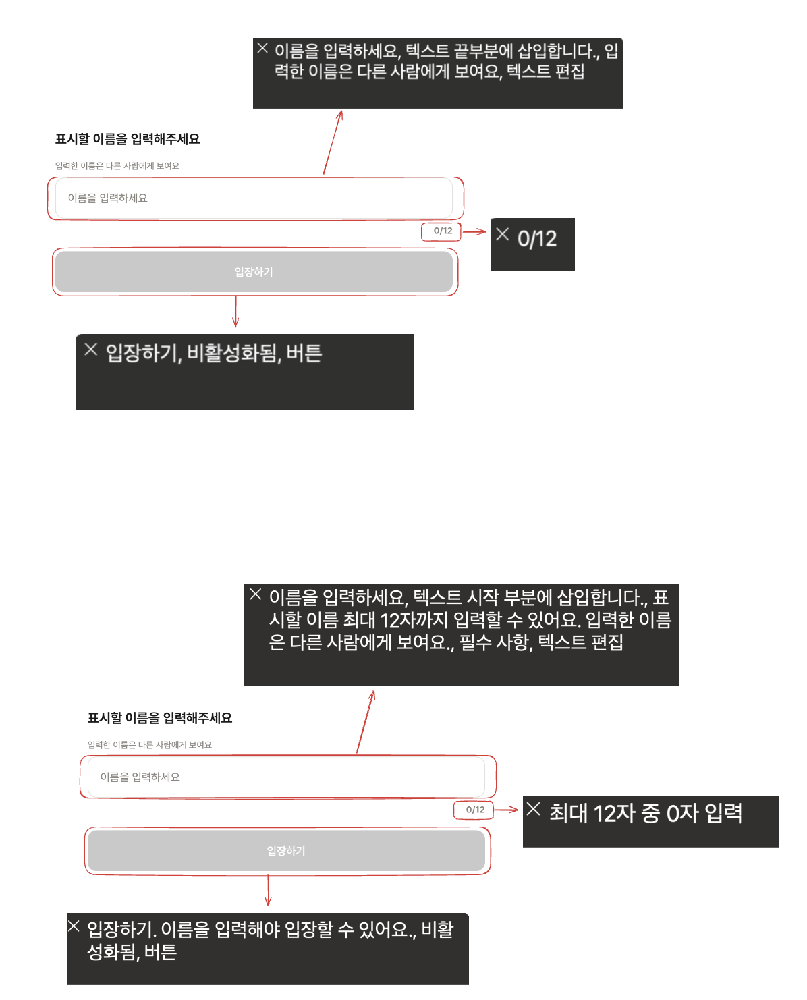
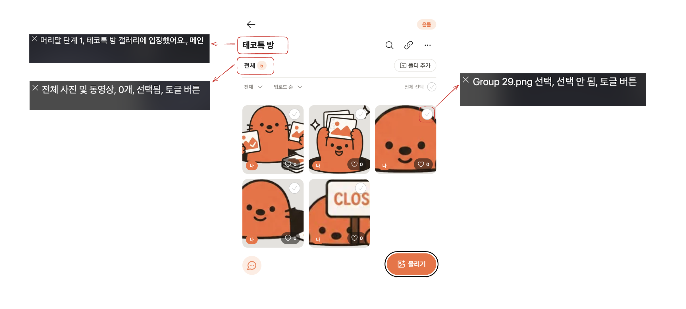
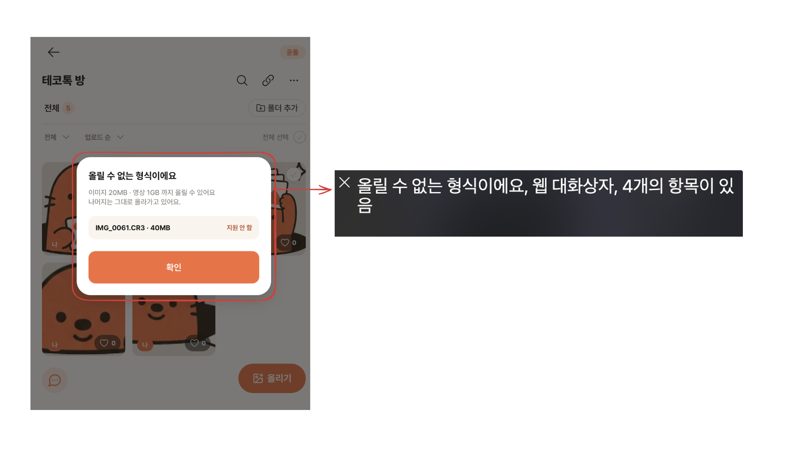
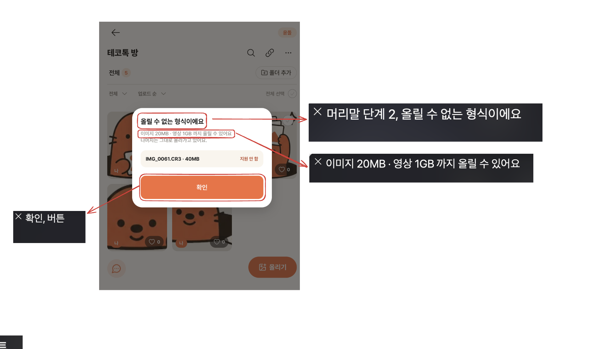

# 주요 기능 접근성 점검 및 개선 기록

## 점검 목적과 범위

스크린리더로 **이름 입력 → 갤러리 입장 → 사진 업로드 → 사진 조회** 흐름을 이용할 때, 현재 위치와 입력 조건을 이해하고 필요한 버튼에 접근할 수 있는지 점검했다.

기존 화면의 문구와 배치는 유지하면서 각 요소의 접근성 이름·설명·상태와 모달 포커스 동작을 개선했다. 사용자 제공 개선 전후 낭독 화면, 사용자의 직접 확인 결과, 구현 코드와 자동 테스트를 근거로 정리했다.

스크린리더가 덧붙이는 “머리말 단계”, “필수 사항”, “비활성화됨”, “토글 버튼”, “텍스트 편집” 등은 앱이 지정한 문구와 구분한다. 브라우저·스크린리더 버전과 세부 설정은 이번 기록에서 수집하지 않았다.

## 1. 이름 입력

### 관찰한 문제

입력란이 이름보다는 공개 범위 안내로 읽혔다. `0/12`는 숫자의 의미가 불분명했고, “입장하기, 비활성화됨, 버튼”만으로는 입장할 수 없는 이유를 이해하기 어려웠다.

| 점검 질문 | 해결 방법 | 개선 후 문구·결과 |
| --- | --- | --- |
| 입력란에 이름 레이블이 연결되어 있는가? | 화면의 기존 안내는 유지하고 입력란의 접근성 이름을 지정 | **“표시할 이름”** |
| 필수 입력·최대 12자 조건을 알 수 있는가? | 필수 속성을 지정하고 길이 제한·공개 범위를 입력란 설명에 연결. 필수 속성으로 이미 읽히는 문장은 중복하지 않음 | **“최대 12자까지 입력할 수 있어요. 입력한 이름은 다른 사람에게 보여요.”** + 스크린리더의 “필수 사항” |
| 글자 수 표시의 의미를 알 수 있는가? | 화면의 `0/12`는 유지하고 낭독할 때 풀어 쓴 문구 제공 | **“최대 12자 중 0자 입력”**. 입력값에 따라 갱신 |
| 입장 버튼이 비활성화된 이유와 입력 오류가 전달되는가? | 버튼 이름에 미입력·공백 입력의 이유를 연결. 공백만 입력하면 입력란에도 오류 상태 제공 | 미입력: **“입장하기. 이름을 입력해야 입장할 수 있어요.”** / 공백: **“입장하기. 공백을 제외한 이름을 입력해야 입장할 수 있어요.”** |
| 키보드로 입력하고 입장할 수 있는가? | 기존 입력 폼과 제출 버튼 동작 유지 | 자동 테스트에서 입력 후 Tab으로 입장 버튼에 이동하는 것을 확인. 실제 키보드 Enter 입장은 추가 확인 필요 |

**확인 결과:** 사용자 제공 개선 후 화면에서 입력란 설명·필수 상태, 글자 수의 의미, 미입력 시 비활성화 이유가 전달됨을 확인했다. 공백 오류 낭독은 코드·테스트로 확인한 구현이며 실제 낭독은 별도 확인이 필요하다.

## 2. 갤러리 입장

### 관찰한 문제

제목이 “테코톡 방”으로만 읽혀 현재 화면이 갤러리인지, 입장이 완료됐는지 알기 어려웠다. 최초 점검에서는 입장 직후 도착 안내도 듣지 못했다.

| 점검 질문 | 해결 방법 | 개선 후 문구·결과 |
| --- | --- | --- |
| 입장 성공과 현재 갤러리 이름을 알 수 있는가? | 제목의 접근성 이름에 갤러리 이름과 도착 사실을 함께 제공 | **“테코톡 방 갤러리에 입장했어요.”** |
| 화면 전환 후 포커스가 적절한 위치에 놓이는가? | 갤러리 진입 시 제목으로 포커스 이동. 일반 Tab 순서에는 제목을 추가하지 않음 | 자동 테스트에서 진입 후 제목 포커스 확인. 실제 스크린리더 커서의 자동 이동은 별도 확인 필요 |
| 로딩·입장 실패 상태를 구분할 수 있는가? | 기존 로딩 상태 안내 유지, 입장·조회 실패 문구에 알림 역할 연결 | **“로그인 정보를 불러오는 중이에요.”**, **“방 정보를 불러오는 중이에요.”**, **“입장하지 못했어요. 잠시 후 다시 시도해주세요.”** 등. 실제 오류·로딩 낭독은 추가 확인 필요 |

### 같은 화면에서 보강한 상태 안내

| 요소 | 개선 내용 | 확인 결과 |
| --- | --- | --- |
| 전체 버튼 | **“전체 사진 및 동영상, N개”**와 선택 상태 제공 | 사용자 화면에서 “전체 사진 및 동영상, 0개, 선택됨, 토글 버튼” 낭독 확인. 화면에는 5개로 보여 숫자 불일치는 미해결 항목으로 남김 |
| 사진 선택 토글 | 기존 토글 상태 속성을 유지하면서 이름에도 상태를 명시 | 미선택: **“[파일명] 선택, 선택 안 됨”**, 선택: **“[파일명] 선택, 선택됨”**. 미선택 낭독은 사용자 화면에서 확인, 선택 후 문구 변화는 자동 테스트로 확인 |

**확인 결과:** 갤러리 이름·도착 사실과 사진 미선택 상태가 낭독되는 것을 확인했다. 제목의 자동 포커스와 사용자가 수동으로 제목을 찾아 읽은 결과는 구분해서 기록했다.

## 3. 사진 업로드

### 관찰한 문제

“사진 올리기, 버튼”은 읽혔고 파일 선택창을 열 수 있었다. 초기 관찰에서는 파일 선택 취소 후 원래 버튼으로 돌아왔지만 업로드 결과 안내는 듣지 못했다.

이후 업로드할 수 없는 파일을 골랐을 때 오류 모달이 떠도 내부로 진입하기 어렵고 확인 버튼에도 접근하기 어려운 문제가 확인됐다. 대화상자라는 사실이 읽히는 것과 내부를 실제로 조작할 수 있는 것은 달랐다.

| 점검 질문 | 해결 방법 | 개선 후 문구·결과 |
| --- | --- | --- |
| 업로드 버튼의 목적을 이해하고 키보드로 실행할 수 있는가? | 목적이 명확한 기존 버튼 유지 | **“사진 올리기, 버튼”**. 파일 선택창 열기는 초기 사용자 관찰에서 확인. 키보드만으로 실행하는 전체 경로는 추가 확인 필요 |
| 파일 선택 취소 후 버튼으로 돌아오는가? | 기존 동작 유지 | 초기 사용자 관찰에서 원래 버튼으로 복귀 확인. 이번 모달 수정 후 파일 선택 취소 경로는 별도 재확인 필요 |
| 진행·성공·실패와 일부 실패를 알 수 있는가? | 진행 표시와 오류별 안내 구현을 확인하고, 거절·실패 모달에 접근할 수 있도록 개선 | 지원하지 않는 형식의 거절 안내는 실제 확인. 업로드 진행률·전체 성공·부분 실패의 전체 낭독은 이번에 확인하지 않음 |
| 실패 이유와 대응 방법이 전달되는가? | 오류 제목·본문을 대화상자에 연결하고 내부 콘텐츠·확인 버튼 접근 보장 | **“올릴 수 없는 형식이에요”**, **“이미지 20MB · 영상 1GB 까지 올릴 수 있어요”**, **“확인, 버튼”** 접근·낭독 확인. 화면의 파일별 “지원 안 함” 낭독과 재시도 가능한 실패의 “실패만 재시도” 동작은 별도 확인 필요 |

### 오류 모달 개선 방법

- 일반 요소에 대화상자 역할만 선언하던 구조에서 네이티브 모달 대화상자로 전환했다.
- 모달이 열리면 대화상자 자체로 포커스를 옮기고 배경 화면을 조작하지 못하게 했다.
- Tab·Shift+Tab으로 내부 버튼을 순환하고 Enter로 실행할 수 있도록 했다.
- Escape로 닫고, 열기 전 요소가 남아 있으면 해당 요소로 포커스를 복원한다.
- 업로드 거절·실패 모달의 제목과 설명을 대화상자에 명시적으로 연결했다.

**확인 결과:** 사용자가 개선 후 모달 내부에 접근할 수 있음을 확인했다. 첨부 화면에서 제목·용량 안내·확인 버튼의 낭독도 확인했다. 모달 개방 즉시 자동 진입, 확인 실행, 닫은 뒤 복귀의 모든 단계를 이미지 한 장으로 확인한 것으로 보지는 않는다. 내부 포커스 이동·순환·Enter 실행·이전 포커스 복귀는 자동 테스트로 보완했다.

**개선 전**

**개선 후**

## 4. 사진 조회

사용자는 사진 조회 흐름이 대체로 정상적으로 동작한다고 평가했다. 이 단계에서는 추가 구현 없이 코드를 확인해 현황만 정리했다.

| 점검 질문 | 코드에서 확인한 내용 | 결과 |
| --- | --- | --- |
| 파일명 대신 사진 내용을 이해할 수 있는 설명이 제공되는가? | 목록 썸네일·확대 이미지의 대체 텍스트와 열기 버튼에 파일명 사용 | **미충족.** “[파일명] 크게 보기”는 동작 안내이며 사진 내용 설명은 아님 |
| 업로더와 목록 내 위치를 알 수 있는가? | 업로더는 목록 배지·확대 보기 하단에 표시. 확대 보기에는 `현재 / 전체` 위치 정보가 있고 변경을 알리는 속성 제공 | **부분 충족.** 목록의 사진 열기 버튼 이름에는 업로더·순번이 없음 |
| 키보드로 사진을 열고 이전·다음 사진으로 이동할 수 있는가? | 기본 버튼으로 열기, 이전·다음 버튼과 좌우 방향키 지원 | **구현 확인.** “이전 사진”, “다음 사진” |
| 크게 보기를 닫으면 원래 사진으로 돌아오는가? | 열기 전 포커스를 저장하고 닫을 때 복원. Escape·“갤러리로 돌아가기”로 닫기 | **구현 및 포커스 복귀 테스트 확인.** 원래 사진이 삭제된 경우 대체 복귀 위치는 없음 |

## 남은 확인 항목

- 화면의 사진 개수와 스크린리더가 읽는 개수의 일치 여부.
- 갤러리 입장 직후 실제 스크린리더 커서가 제목으로 이동하는지.
- 업로드 진행·성공·부분 실패·재시도의 실제 낭독과 조작 흐름.
- 오류 모달 자동 진입부터 확인 실행·닫기·복귀까지 연속 조작.
- 사진 내용을 설명하는 대체 텍스트, 목록에서 업로더·순번 전달.

이번 점검은 위 네 가지 주요 기능에 한정한 개선 기록이며, 서비스 전체의 접근성 준수 판정은 아니다.

## 검증 기록

- 최신 develop 반영 후 이름 입력·공통 입력·갤러리·사진 선택·모달·업로드·확대 보기 관련 테스트 **12개 스위트, 137개 통과**.
- TypeScript 타입 검사 및 변경된 소스의 ESLint·Prettier 검사 통과.
- 실제 낭독 확인은 사용자가 제공한 개선 전후 화면과 직접 확인한 결과를 근거로 기록.
- 화면을 유지한 상태에서 접근성 문구와 조작 동작을 개선했으며, 자동 테스트 통과를 실제 스크린리더 검증 완료와 동일하게 취급하지 않음.
