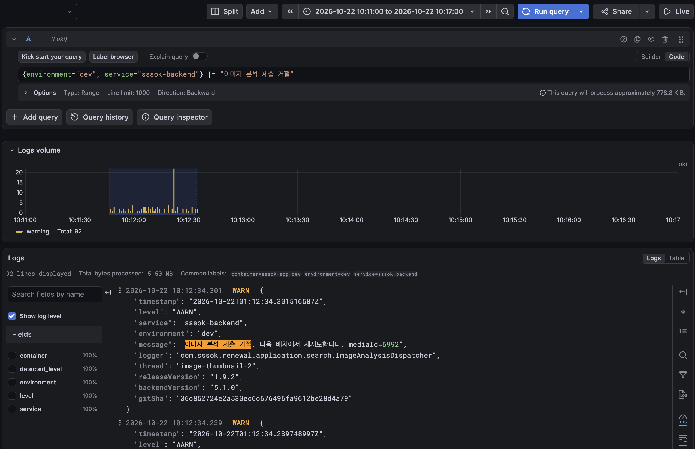
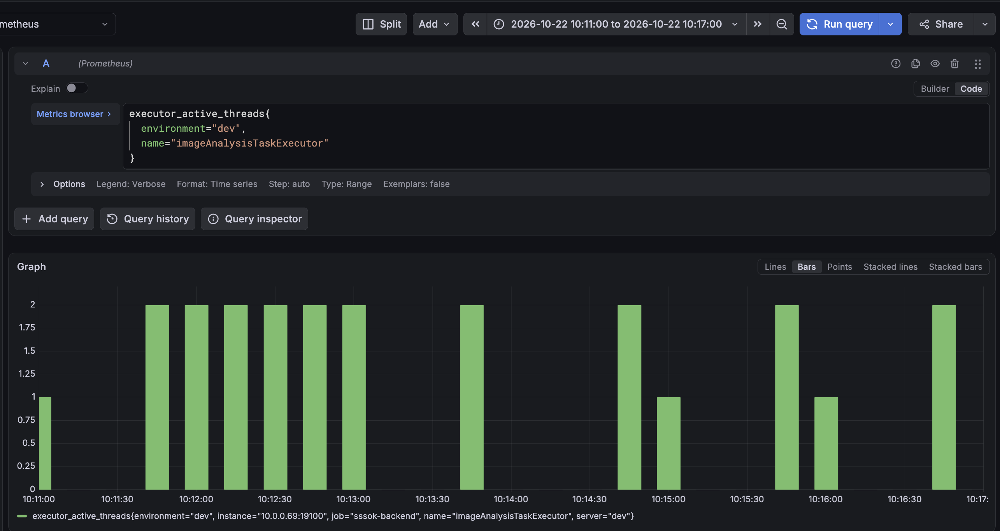
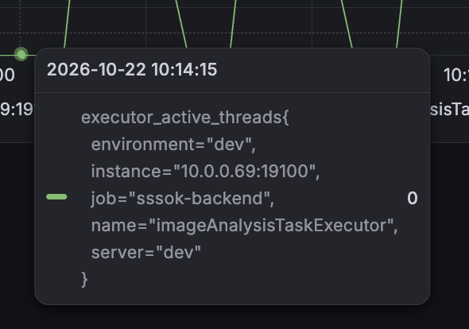
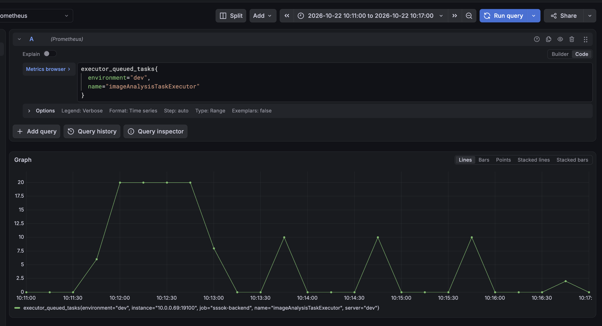

# 업로드는 성공했는데 AI 분석은 왜 4분을 기다렸나?

> 이슈: [#557](https://github.com/woowacourse-teams/2026-sssOK/issues/557) · 상위 [#556](https://github.com/woowacourse-teams/2026-sssOK/issues/556) · 작성: 2026-10-23 KST
> 상태: DB 큐 연속 소비 구현 및 로컬 검증. **dev 배포·개선 후 실부하 측정 전**.

## 1. 결론과 이번 변경의 범위

**AI 작업을 DB에 보관하는 안전성은 유지하고, 빈 워커가 다음 작업을 바로 가져오도록 바꾼다.**

- 현상: 업로드·썸네일·SSE·AI 분석은 최종 성공했지만, AI 시작 전 대기가 수분으로 늘었다.
- 원인 근거: 실행기 제출 거절, DB PENDING 잔존, 워커·메모리 큐가 빈 표본, 약 60초마다 20장 재공급을 연결해 확인했다.
- 선택: 별도 메모리 대기 큐를 없애고 DB에서 작업을 원자적으로 선점해 연속 처리한다.
- 비교 기준: AI 동시성은 우선 기존 2개 유지. 배정 방식의 효과를 확인한 다음 4개와 비교한다.
- 범위: AI 배정 경로를 변경한다. 썸네일·SSE 지연 원인은 별도이며 이 변경으로 해결했다고 주장하지 않는다.
- 공개 API·스키마는 변경하지 않는다. 기존 분석 테이블, 결과 체크포인트, 재시도 정책을 재사용한다.

## 2. 무엇을 측정했나?

업로드 접수, 화면에 표시할 준비, AI 검색 준비는 각각 다른 완료 지점이다.

```text
URL 발급 → 스토리지 PUT → 업로드 완료 등록
                              ↓
                       썸네일·프리뷰 준비
                              ↓
                       MediaReadyEvent
                        ↙           ↘
                    SSE 수신       AI 작업 등록
                                      ↓
                              대기 → 분석 → 결과 저장
```

- `stored_file.READY`: 미디어 준비 상태다.
- `media_search_document.READY`: AI 분석 완료 상태다.
- k6의 `media.ready` 수신 지연은 썸네일 처리와 이벤트 전달을 포함한다. SSE 전송만의 시간은 아니다.
- SQL의 AI 전체 지연은 분석 작업 등록부터 완료까지다. 업로드 시작부터의 사용자 전체 지연은 아니다.

### 시험 조건

- 대상: dev API, backend `5.1.0`, release `1.9.2`, SHA `36c852724e2a530ec6c676496fa9612be28d4a79`.
- 실행: 별도 ARM64 부하 발생 EC2, k6 `2.3.0` + SSE 확장.
- 실행 ID: `upload-ai-20261022T010830Z`; 시드 방 138, 스모크 방 139, 2pps 방 140.
- 이미지: 생성 PNG 1280×960, 평균 약 345KB, 5개 이미지 재사용. 실제 고해상도 사진·의미적 검색 품질의 대표 표본은 아니다.
- 입력: 10장 묶음. 스모크 3명×2회=60장. 목표 2장/초, 예열 30초·본 측정 30초, 업로더 계정 50개.
- 계획 190장과 달리 실제 210장(시드 10+스모크 60+부하 140)이 등록됐다. 각 부하 구간 7묶음=70장으로, 30초 분모상 2.33장/초다.
- 이 입력량 차이의 정확한 스케줄링 원인은 아직 확인하지 않았다. 다음 비교 전에 계획·실제 수량 및 비용 예산 계산을 보정해야 한다.
- 자료: 사용자가 제공한 REPORT, suite.json, 단계별 k6 요약·로그·자원 기록, DB SQL 결과, Grafana 화면.
- `UPLOAD_FINISHED_AI_UNVERIFIED`는 업로드 실패가 아니라 AI 완료를 SQL로 확인하기 전 상태다.

### 업로드 결과

| 항목 | 스모크 | 2pps 본 측정 |
|---|---:|---:|
| URL 발급 p95 | 97.07ms | 109.95ms |
| 스토리지 PUT p95 | 330.38ms | 369.51ms |
| 완료 등록 p95 | 1172.30ms | 921.41ms |
| HTTP·업무 실패 / 실행 누락 | 0 / 0 | 0 / 0 |
| 썸네일 준비 SSE 지연 p95 | 23.98초 | 6.43초 |
| 준비 이벤트 누락 | 0 | 0 |

- 부하 구간의 SSE 지연은 예열·본 측정 전체 140장 기준이다. API p95와 집계 구간이 다르다.
- 첫 별도 스모크에서도 준비 지연 p95가 23.57초였다. 순간 집중 입력의 지연을 재현했지만 구간별 원인은 아직 미분리다.
- 발생기 가용 메모리 최소 2.45GiB, k6 RSS 표본 최대 약 339MiB였다. 이는 dev 앱 서버의 메모리 수치가 아니다.
- 본 측정 URL 발급·완료 등록은 각 7회여서 장기 p95나 안정 처리량을 입증하지 않는다.

### AI 최종 결과

| 단계 | 파일 / AI 완료 | 시작 전 대기 p95 | 시작 후 처리 p95 | 전체 분석 지연 p95 |
|---|---:|---:|---:|---:|
| seed | 10 / 10 | 9.37초 | 3.69초 | 12.24초 |
| smoke | 60 / 60 | 84.89초 | 3.15초 | 87.76초 |
| 2pps | 140 / 140 | **236.35초** | **3.12초** | **238.83초** |

- 최종 누락·PENDING·PROCESSING·FAILED는 0이다. 14:31 최종 조회가 그때까지 분석했다는 의미는 아니다.
- 각 p95는 독립 통계이므로 합산하지 않는다. 대기·처리 p95는 READY 중 최초 시도, 전체 지연은 READY 전체 기준이다.
- 미완료 작업이 있던 초기 p95 약 104초는 먼저 끝난 작업만 포함했다. 최종 약 239초와 단순 전후 성능 비교를 하면 안 된다.
- 분석 처리에는 외부 API·DB 작업이 포함된다. 결과 저장만 4분 걸렸다는 근거는 없다.

## 3. 로그·SQL·Grafana로 원인을 연결했다

한 종류의 지표로 단정하지 않고, 동일 시험의 작업 상태와 실행기 상태를 대조했다.

### 근거 A — 실행기에 작업을 넣지 못했다

- 10:11~10:17 KST에 `이미지 분석 제출 거절` 로그가 92줄 조회됐다.
- 조회: `{environment="dev", service="sssok-backend"} |= "이미지 분석 제출 거절"`.
- 92는 로그 횟수다. 고유 사진 92장 또는 전부 방 140의 작업이라고 단정하지 않는다.
- 펼친 로그의 backend/release/SHA는 시험 버전과 일치했다.



### 근거 B — 사진 하나가 실제로 241초를 기다렸다

- 로그의 mediaId 6992를 DB로 조회해 방 140 시험 사진임을 확인했다.
- 시도 횟수는 1이다. 분석 실패 재시도로 4분을 소비한 사례가 아니다.

| 동작 | KST 시각 |
|---|---|
| 작업 등록 | 10:12:34.298 |
| 실행기 제출 거절 | 10:12:34.301 |
| 분석 시작 | 10:16:35.478 |
| 분석 완료 | 10:16:37.883 |
| 대기 / 처리 | **241.18초 / 2.41초** |

### 근거 C — 1분마다 20장씩 작업이 시작됐다

- DB `started_at`을 10초 단위로 집계했다. 해당 사진들은 재시도 0건이다.
- 10:13:20~49에 20장, 10:14:20~49에 20장, 10:15:20~49에 20장, 10:16:20~39에 남은 12장이 시작됐다.
- 각 버킷의 평균 처리 시간은 약 2.45~2.86초였지만 뒤쪽 작업의 평균 대기는 약 100→150→200→240초로 증가했다.
- 코드의 기본 `sweep-delay=60000`, `batch-size=20`과 관측 패턴이 일치한다. 고정 지연은 배치 실행 시간만큼 더 길어질 수 있다.

### 근거 D — DB에 대기가 남아도 워커와 실행 큐가 비었다

- 10:14:08 SQL: PENDING 52, 그중 실행 시각 도래 52, PROCESSING 0, READY 88.
- 10:14:15 Grafana 툴팁: `executor_active_threads=0`. 실제 0 값으로 수집 공백과 구분했다.
- 같은 시간대 `executor_queued_tasks=0`; 초기 입력 중에는 큐 20개까지 찼다.
- SQL과 메트릭은 수 초 차이의 관측이고 그래프는 표본이다. 연속 유휴 시간의 정확한 길이나 모든 시점의 상태까지 단정하지 않는다.







### 원인 판단

- 입력이 처리 능력을 넘으면 메모리 큐가 차고, 거절된 작업은 DB에 남는다.
- 실행기는 메모리 큐를 비워도 DB를 직접 읽지 않는다. 주기적 복구가 정상 적체 공급까지 맡는다.
- 결과적으로 처리 용량 부족에 **작업 공급 공백**이 추가된다.
- AI 재시도 실패나 DB 결과 저장 지연을 이번 장기 대기의 주원인으로 볼 증거는 없다.
- 썸네일 지연은 다른 경로이므로 따로 조사한다.

## 4. 썸네일 워커 4개에는 기존 실측 근거가 있다

**기록이 없는 것이 아니라 앞선 조사에서 놓쳤다.** 썸네일의 4개 선택과 AI 동시성은 구분한다.

- 문서: [THUMBNAIL_JOB_QUEUE.md — 워커 비교](THUMBNAIL_JOB_QUEUE.md#워커-2개4개-비교-결과-2026-10-14).
- PR: [#535 썸네일 작업 유실 방지와 큐 워커 처리 개선](https://github.com/woowacourse-teams/2026-sssOK/pull/535), 이슈 #532.
- 커밋: `321a7d6bc21272daf57b1ef062231eed434e71f2` — 실측 결과에 따라 이미지 워커 기본값 4개 적용.
- 채팅: 「Plan implementation for issue #532」, ID `01a13a33-f16f-74c1-9e2f-6ec21ad82838`. 사용자도 4개 유지·AI 활성 시험은 후속으로 결정했다.
- 조건: 2026-10-14, 같은 커밋 `3be3c7c6`, t4g.small 2 CPU·RAM 1835MiB, PNG 1280×960 300장, 30계정/1방, 묶음 동시성 3, **AI 비활성**, 설정별 1회.

| 항목 | 썸네일 2개 | 썸네일 4개 |
|---|---:|---:|
| 시작→전체 READY 확인 | 288초 | 153초 |
| 마지막 업로드→전체 READY 확인 | 251초 | 115초 |
| 성공 / 실패 / 재시도 | 300 / 0 / 0 | 300 / 0 / 0 |
| 작업당 평균 처리 시간 | 1.825초 | 1.894초 |
| 최대 Docker 메모리 | 788.5MiB | 832.9MiB |
| 최소 가용 메모리 | 462.7MiB | 441.3MiB |
| 최대 CPU, 2 CPU 합산 | 151.35% | 165.21% |

- 선택 이유: 전체 확인 시간 약 47% 감소, 관측 최대 메모리 44.4MiB 증가. 단건 시간은 조금 늘어도 병렬 처리 이득이 컸다.
- 한계: 각 1회, 예열·CPU 크레딧 미통제, 계정 생성·업로드·5초 READY 조회 포함. p95나 순수 변환 시간은 아니다.
- AI 활성·고해상도·일반 API 영향은 당시 미검증이었다. 이 결과로 AI 워커 4개가 최적이라고 일반화하지 않는다.
- 현재 선택: 썸네일 4개 유지. AI는 2개로 구조 효과를 확인하고 같은 새 코드에서 4개를 추가 비교한다.

## 5. 선택지와 트레이드오프

각 선택지는 해결하는 문제가 다르다. 단계가 높을수록 무조건 좋은 구조는 아니다.

### 선택지 A. 재제출 주기 단축

- **설명:** 60초 복구 배치를 더 자주 실행하거나 일반 작업 배정을 별도 짧은 주기로 분리한다.
- **장점:** 변경이 작고 공급 공백을 빠르게 줄일 수 있다.
- **단점:** 큐가 찬 상태에서 중복 조회·제출·거절이 반복될 수 있다. 메모리 큐의 작업도 DB에서는 PENDING이다.
- **트레이드오프:** 작은 개발 비용과 짧은 대기를 얻는 대신 DB 조회량·중복 관리 비용을 부담한다.
- **판단:** 임시 완화 수단. 이번에는 연속 소비와 유휴 보조 폴링으로 역할을 분리한다.

### 선택지 B. 메모리 큐 확대

- **설명:** 더 많은 사진 ID를 실행기에 미리 넣어둔다.
- **장점:** 순간 집중 입력의 제출 거절을 줄일 수 있다.
- **단점:** 워커 처리 능력은 그대로다. 큐 내부 대기가 늘고, 재시작 시 메모리 내용은 사라진다. DB 복구는 계속 필요하다.
- **트레이드오프:** 즉시 수용량과 복구 의존 감소를 얻지만 이중 대기 관리·긴 대기를 유지한다. 대기 항목은 사진 ID 중심이므로 이미지 파일 전체가 큐에 올라간다고 해석하지 않는다.
- **판단:** 단독 해결책으로 선택하지 않는다.

### 선택지 C. AI 워커 수 증가

- **설명:** 동시에 외부 API를 호출하는 분석 작업 수를 늘린다.
- **장점:** 제공자 한도와 서버 자원이 허용하면 처리량이 증가한다.
- **단점:** 외부 429·타임아웃·DB·네트워크 경쟁이 증가할 수 있다. 공급 공백은 별개로 남는다.
- **트레이드오프:** 처리량과 자원·호출량 사이의 균형이다. 같은 사진 수면 비용이 무조건 늘지는 않지만 비용 발생 속도와 재시도 가능성이 달라진다.
- **판단:** 구조 개선 후 2개·4개 비교. 썸네일 4개의 실측은 참고이지 AI의 최적값 근거가 아니다.

### 선택지 D. DB 큐에서 워커가 연속 선점 — 채택

- **설명:** DB를 유일한 대기열로 사용한다. 실행 중인 워커가 한 작업을 마치면 다음 실행 가능한 작업을 바로 선점한다.
- **장점:** DB 적체가 있는데 다음 60초 배치를 기다리는 공백과 중복 메모리 큐 제출을 줄인다. 기존 DB·상태·AI 안전장치를 재사용한다.
- **단점:** 선점 경합·프로세스 중단·재시도 시각·슬롯 반환을 검증해야 한다. 작업당 DB 상태 변경과 유휴 조회 비용이 있다.
- **트레이드오프:** 새 인프라 운영 대신 DB 큐 구현 책임을 갖는다. 동시성은 유지하되 공급 효율을 높인다.
- **선택 근거:** 이번에 확인한 원인과 직접 연결되고, 썸네일에 유사 구조와 검증 경험이 있다. 외부 API 결과 불명확 정책은 썸네일 정책으로 대체하지 않는다.

### 선택지 E. 별도 워커 서버 + SQS/RabbitMQ

- **설명:** 전달·대기를 외부 큐로 옮기고 분석 워커를 독립 운영한다. 별도 워커 서버는 DB 큐와 함께 먼저 도입할 수도 있다.
- **장점:** API와 자원 격리, 독립 확장, 큐 서비스의 재전달 기능을 활용한다.
- **단점:** DB 저장과 메시지 발행의 정합성, 중복 전달, ack/삭제, visibility timeout, 장애 큐 운영이 필요하다.
- **트레이드오프:** 독립 확장성을 얻는 대신 운영 요소와 분산 실패 경우가 늘어난다. 큐 교체만으로 외부 API 처리 능력은 늘지 않는다.
- **판단:** 독립 운영·DB 큐 부하가 실제 요구가 될 때 검토한다. 현재 결함 해결의 필수 조건은 아니다.

### 선택지 F. Kafka 기반 이벤트 소비

- **설명:** 준비 이벤트를 보관하고 분석·통계·추천 등이 소비자 그룹별로 읽는다.
- **장점:** 여러 기능의 독립 소비와 이벤트 재생에 유리하다.
- **단점:** 파티션·offset·재처리·오래 걸리는 작업의 소비 관리가 추가된다.
- **트레이드오프:** 이벤트 플랫폼 기능과 운영 복잡성의 교환이다. SQS보다 상위 단계라는 의미는 아니다.
- **판단:** 단일 분석 대기 문제를 위해 도입하지 않는다.

## 6. 이번에 구현한 방식

**워커 슬롯을 먼저 확보하고 실제 워커가 실행된 뒤 DB 선점을 시작한다.** 제출 실패 시 DB 작업 상태를 되돌리는 경계를 줄였다.

```text
준비 이벤트 → PENDING 등록·커밋 → 빈 워커 깨우기
                                       ↓
                              DB에서 다음 작업 선점·커밋
                                       ↓
                              설명 생성·체크포인트 저장
                                       ↓
                              임베딩·최종 결과 저장
                                       ↓
                     다음 작업 있음 → 같은 워커로 즉시 반복
                     다음 작업 없음 → 슬롯 반환·종료
```

- 선점: 짧은 repository 트랜잭션에서 `FOR UPDATE OF candidate SKIP LOCKED`로 후보를 선택하고 `UPDATE ... RETURNING`으로 PROCESSING 변경·시도 번호 증가·결과 반환을 SQL 한 번으로 수행한다. JPA 저장소의 네이티브 쿼리와 반환값 프로젝션으로 기존 선택→변경→재조회 세 번의 DB 호출을 줄인다.
- 잠금: 외부 API 호출 전에 선점 트랜잭션이 끝난다. 외부 호출 중 DB 연결을 계속 잡지 않는다.
- 실행기 여유: 최대 스레드는 `concurrency + 1`로 둔다. 슬롯 반환 직후 기존 스레드가 종료 처리 중일 때의 제출 거절을 완화한다. 분석 동시 실행 수는 Semaphore로 기존 제한을 유지한다. 모든 제출 거절을 제거하는 것은 아니며, 거절된 경우 DB 작업을 보존하고 기본 1초 폴링으로 재배정한다.
- 슬롯: 인스턴스별 Semaphore로 최대 동시성을 제한한다. 예외·빈 큐·거절 시 반환한다. 처리 중 인터럽트면 다음 작업 선점을 중단한다.
- 실행기 큐: 항상 0. 기존 `queue-capacity` 속성은 설정·생성자 호환을 위해 남지만 실행기 크기에는 적용하지 않는다.
- 일반 배정: `media.search.dispatch-delay`, 기본 1000ms. 시작·이벤트 종료 경합·재시도 시각 도래를 보완한다. 작업을 처리하는 사이에는 이 주기를 기다리지 않는다.
- 복구 배치: 기존 60000ms 유지. 누락 등록·오래된 PROCESSING 복구 후 워커를 깨운다. 20개는 누락 등록 상한이며 정상 대기 작업의 공급 상한으로 사용하지 않는다.
- 유휴 비용: 기본 2개 워커와 1초 폴링이면 폴링마다 최대 두 번의 빈 선점 조회가 생길 수 있다. 이벤트도 배정 신호를 준다. 부하와 DB 응답을 관측해 조정한다.
- 유지하는 안전장치: 설명 체크포인트, 제공자 재시도 시각, 지수 대기, 최대 시도, 외부 결과 불명확 시 자동 재호출 금지, 실행 차수에 의한 오래된 결과 차단.
- 이번 변경은 새 heartbeat/lease를 도입하지 않는다. 기존 `stuck-after`와 불명확 외부 호출 복구 정책을 유지한다.
- 전체 동시성은 인스턴스 수×설정값이다. 클러스터 전체 호출률 제한은 별도 과제다.

### 설정 판단: 왜 먼저 2개인가?

- dev Compose에 `MEDIA_SEARCH_CONCURRENCY`(기본 2), `MEDIA_SEARCH_DISPATCH_DELAY`(기본 1000ms)를 전달하도록 추가했다. `.env`를 바꿨다면 컨테이너 재생성이 필요하다. 운영 Compose는 이번에 바꾸지 않는다.
- 해당 환경변수는 Spring 설정에 바인딩된다. 실제 적용값은 컨테이너 환경과 런타임 메트릭으로 함께 확인한다.

- 2개가 최적이라는 의미가 아니다. 기존 측정과 동시성을 맞춰 배정 구조만의 효과를 보기 위함이다.
- 평균 2.6초를 단순 적용하면 2개는 약 0.77장/초, 4개는 약 1.54장/초다. 호출 속도 불변·유휴 없음의 가정이며 실측 보장이 아니다.
- 지속 2장/초에는 산술적으로 6개 이상이 필요하지만, 변동 여유·외부 API 한도·서버 자원까지 검증해야 한다.
- 공급 공백 제거와 용량 확대는 별도 실험으로 나눈다. 완료 지연 목표 자체도 확정해야 한다.

## 7. 검증과 재측정

로컬 정합성 검증과 dev 성능 검증을 구분한다. 로컬 통과는 p95 개선 증명이 아니다.

### 로컬 검증

- 2026-10-23 실행 결과: **38개 통과, 실패·오류·건너뜀 0**. 디스패처 3개, PostgreSQL 저장소 12개, 분석 워크플로 23개.
- 2026-10-24 리뷰 반영 후: **40개 통과, 실패·오류·건너뜀 0**. 실제 실행기 설정의 동시성 제한 검증, 선점의 트랜잭션 롤백·재시도 번호 반환 테스트 추가. 디스패처 3개, PostgreSQL 저장소 14개, 분석 워크플로 23개.

- 단위: 한 번의 배정으로 60개 연속 소비, 동시성 2 상한, 반복 깨우기, 제출 거절 시 미선점·슬롯 반환, DB 오류·빈 큐 후 재개.
- PostgreSQL: 서로 다른 워커의 경쟁 선점, 재시도 시각·최대 시도 준수, 기존 삭제·복구·실패·체크포인트 정책.
- 실제 DB→실행기→분석→저장 경로: 25장(기존 배치 상한 20 초과)을 단 한 번의 배정으로 끝까지 처리. 외부 API는 테스트 대역이다.
- 실행 명령:

```bash
cd backend
./gradlew unitTest --tests '*ImageAnalysisDispatcherTest'   integrationTestPostgres --tests '*MediaSearchDocumentRepositoryTest'   --tests '*ImageAnalysisWorkflowTest'
```

### dev 재시험 순서

1. 변경 검토·PR·사람의 병합 또는 별도 승인된 dev 임시 배포가 필요하다. 현재 서버는 이 수정이 적용됐다고 가정하지 않는다.
2. 기존 작업을 배출하고 시험 시작 전 AI PENDING/PROCESSING, 앱 SHA, 인스턴스 수, 실제 동시성 설정을 저장한다.
3. 입력 수량 초과 문제를 보정한 스크립트를 이전/이후 버전에 동일하게 적용한다. 과거 140장 결과는 참고 기준으로 남긴다.
4. 같은 이미지·시드·스모크·분산 입력을 사용한다. 각 시험은 이전 AI 적체가 해소된 뒤 시작한다.
5. AI 2개로 새 구조를 측정한 뒤 같은 새 코드에서 4개를 측정한다. 썸네일은 기존 4개를 유지한다.
6. SQL은 약 10초 간격, 메트릭은 기존 수집 해상도를 확인해 관측한다. 스크린샷뿐 아니라 CSV/JSON과 실행 식별자를 보존한다.
7. 오류·429·불명확 결과·메모리 압박·기존 API 악화가 발생하면 입력을 중단하고 잔여 작업 상태를 기록한다. 작업이 진행 중일 때 방을 삭제하지 않는다.

### 관측 쿼리

```promql
executor_active_threads{environment="dev",name="imageAnalysisTaskExecutor"}
executor_queued_tasks{environment="dev",name="imageAnalysisTaskExecutor"}
hikaricp_connections_pending{environment="dev",job="sssok-backend"}
```

- 새 구조에서는 실행기 큐 0이 정상이다. DB 적체가 0이라는 뜻으로 해석하지 않는다.
- SQL의 실행 가능한 PENDING과 active를 함께 보고 불필요한 장기 공백이 사라졌는지 판단한다.
- 아래 SQL은 방 140의 기존 근거를 재조회한다. 새 실행에서는 실제 시험 방 ID로 바꾼다.

```sql
SELECT clock_timestamp() AS observed_at,
       count(*) AS analysis_rows,
       count(*) FILTER (WHERE d.status = 'PENDING' AND d.next_attempt_at <= now()) AS eligible,
       count(*) FILTER (WHERE d.status = 'PENDING' AND d.next_attempt_at > now()) AS retry_wait,
       count(*) FILTER (WHERE d.status = 'PROCESSING') AS processing,
       count(*) FILTER (WHERE d.status = 'READY') AS ready,
       count(*) FILTER (WHERE d.status = 'FAILED') AS failed,
       max(extract(epoch FROM (now()-d.created_at)))
           FILTER (WHERE d.status = 'PENDING') AS oldest_pending_seconds
FROM media_search_document d JOIN stored_file f ON f.id = d.media_id
WHERE f.room_id = 140;
```

- 파일 행 수·분석 누락은 기존 suite의 LEFT JOIN analysis.sql로 함께 확인한다. 위 집계만으로 누락을 검출할 수 없다.
- READY 증가량/관측 시간으로 완료 처리량을 계산하고, 완료 p95와 미완료 수를 함께 기록한다.

### 전후 비교 표

| 항목 | 기존 실행 | DB 큐·2개 | DB 큐·4개 |
|---|---|---|---|
| 실제 입력 | 2pps 단계 140장 | 미측정 | 미측정 |
| AI 대기 p95 | 236.35초 | 미측정 | 미측정 |
| AI 처리 p95 | 3.12초 | 미측정 | 미측정 |
| AI 전체 p95 | 238.83초 | 미측정 | 미측정 |
| 대기 중 active=0·queued=0 | 관측됨 | 미측정 | 미측정 |
| 최종 분석 완료 / 실패 | 140 / 0 | 미측정 | 미측정 |
| 외부 429·API 지연·DB 대기 | 추가 원본 지표 필요 | 미측정 | 미측정 |

- 완료 기준: 작업 유실·중복 성공 없음, 안전장치 유지, 불필요한 공급 공백 감소, 동일 조건의 대기·완료 지연 개선, 기존 업로드·SSE·API 악화 없음.
- 아직 지속 2장/초 처리 능력이나 운영 장기 안정성을 검증한 것이 아니다.

## 8. 공식 문서와 기존 기록

- [Spring Task Execution and Scheduling](https://docs.spring.io/spring-framework/reference/integration/scheduling.html): 실행기·큐·스케줄러 역할.
- [PostgreSQL SELECT / SKIP LOCKED](https://www.postgresql.org/docs/18/sql-select.html): 여러 소비자가 큐 형태 테이블에서 경합을 피하는 방법.
- [AWS SQS Standard queues](https://docs.aws.amazon.com/AWSSimpleQueueService/latest/SQSDeveloperGuide/standard-queues.html): 중복 전달 가능성과 소비자 처리 책임.
- [AWS Transactional Outbox](https://docs.aws.amazon.com/prescriptive-guidance/latest/cloud-design-patterns/transactional-outbox.html): DB 저장·메시지 전송의 이중 쓰기 문제.
- [RabbitMQ acknowledgements](https://www.rabbitmq.com/docs/confirms): 전송 확인과 처리 확인의 구분.
- [Kafka introduction](https://kafka.apache.org/41/getting-started/introduction/): 파티션·소비자·이벤트 보존.
- [썸네일 DB 작업 큐와 2개·4개 실측](THUMBNAIL_JOB_QUEUE.md), [PR #535](https://github.com/woowacourse-teams/2026-sssOK/pull/535).
