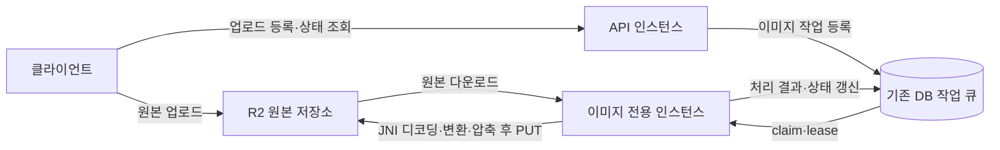

# 이미지 업로드 후처리 개선 및 인스턴스 분리 계획 — #557

2026-11-17. **최종 로컬 반영 후보: JPEG는 libvips JNI, 나머지는 기존 Java method 0 + 썸네일·프리뷰 PUT 병렬화.**
[FFM/JNI 동일 조건 비교와 최종 선택](evidence/557-upload-processing/ffm/RESULTS.md)을 기준으로 한다.
FFM은 같은 출력과 가까운 성능을 보였으나, 현재 동시성 4에서는 네 회차 모두 JNI가 더 빨랐다.
Java 21을 유지하고 CLI·FFM은 비교 실험 소스로만 보존한다.
아래 이전 단계별 기록은 실험 이력이다. 최종 결정은 이 문서 상단과 FFM 비교 문서를 따른다.
코드는 로컬 검증을 마치고 PR 제출 대상으로 정리했다. JNI 배포 후 실서버 검증은 아직 남아 있다.
개선 후 실제 READY, 인스턴스 분리, API 사양 축소는 아래 순서로 진행한다.

전체 업로드의 [20/100/200장 실제 측정 결과](evidence/557-upload-processing/service-scale/RESULTS.md)를 별도로 정리했다.
전체 업로드 비교는 [이전·현재·배포 후 트레이스 측정 계획](evidence/557-upload-processing/service-scale/RUNBOOK.md)을 따른다. 로컬 가공 벤치마크와 실제 업로드 결과를 구분한다.

## 최종 실행 계획

| 순서 | 작업 | 완료 기준 |
| --- | --- | --- |
| 1 | FFM/JNI 비교, 속도 기준 엔진 확정, 코드 정리 | 동일 조건 결과·출력 동등성·계약 테스트 기록. JNI 선택 |
| 2 | dev에 후처리 개선 반영 후 서비스 부하 검증 | 같은 원본 20장·100장·200장 및 동시 업로더로 GET/가공/PUT/큐/READY 비교 |
| 3 | 이미지 워커를 별도 인스턴스로 분리 | API는 이미지 작업을 claim하지 않고 전용 워커가 처리, API 정상 응답 유지 |
| 4 | 기존 API 사양을 한 단계 낮춰 재검증 | 동일 부하에서 합의한 API 지연·오류율·메모리 여유 기준 충족 |
| 5 | API+워커 합산 비용 및 처리량 확인 | 총비용·API p95·READY p95·큐 적체·실패율을 함께 기록 |

### 이미지 워커 분리 설계

- 기존 DB 큐와 claimToken·lease·heartbeat·재시도·완료 처리를 유지한다. 분리를 위해 새로운 메시지 큐를 도입하지 않는다.
- 이미지 작업의 실행 역할을 명시적으로 끄고 켜는 설정을 추가한다. **현재 `image-workers=0`은 기본값 4로 바뀌므로 비활성화 방법이 아니다.**
- API에서 이미지 dispatcher/실행 풀을 끄고, 워커에서 이미지 경로만 켠다. 영상·AI·다운로드 압축·기타 스케줄러의 배치 위치를 따로 확인하여 워커에 중복 기동하지 않는다.
- 원본과 파생본은 R2로 전달하고 API→워커 사이에 대형 이미지 바이트를 중계하지 않는다.
- 새 워커의 DB/R2 연결·헬스체크·메트릭·로그·종료 drain을 먼저 검증하고, 기존 API의 이미지 claim을 중단한다.
  이미 잡은 작업은 완료시킨 후 분리한다. 워커 장애·재시작·lease 만료와 중복 완료 방지도 검증한다.
- 분리 자체가 한 장의 인코딩을 빠르게 하는 것은 아니다. 자원 경합 완화와 독립적인 동시성·사양 조절 효과를 확인한다.

### API 사양 축소 기준

먼저 현재 API 사양을 유지한 채 분리 전후를 관측한다. 이미지 부하가 빠졌다고 JVM·요청 처리·DB 연결·다른 작업의 메모리가 사라지지는 않는다.
Java heap/GC뿐 아니라 컨테이너 전체 메모리·네이티브 메모리·CPU throttling을 확인한다.
대표 최대 부하와 일정 시간의 지속 부하에서 API p95/p99·오류율, 이미지 READY p95·큐 길이/최장 대기,
워커 CPU·메모리·재시도율을 수집한다. API와 워커 사양을 동시에 변경하지 않는다.

분리 후 기준을 확보한 다음 API 사양을 한 단계 낮춘다. 검증 기준은 실행 전에 수치로 고정한다
(예: 기존 API p95 대비 5% 이내, 오류율 증가 없음, OOM·swap 없음, 피크 메모리 여유 25% 이상).
이는 제안 기준이며 현재 서비스의 확정 SLO가 아니다. 기준을 넘으면 직전 사양으로 되돌린다.
이미지 하네스의 메모리만으로 API를 512MiB나 1GiB로 결정하지 않는다.

비용은 줄어든 API 비용과 추가 워커 비용을 합산한다. 실제 인스턴스 생성·사양 변경은 이 계획에 포함된 후속 적용 단계이며 아직 실행하지 않았다.

## 1. 문제 상황

기존 dev에서 1명이 20장을 업로드했을 때 20/20 READY, 오류·누락은 없었지만 완료까지 대기가 길었다.

| 지표 | 기존 측정 평균 |
| --- | ---: |
| 생성 → READY | 8,757.95ms |
| 처리 작업의 큐 대기 | 6,224.70ms |
| 처리 시작 → 처리 종료 | 2,702.27ms |
| 원본 다운로드 | 484.66ms |
| 파생본 생성 | 1,368.67ms |
| 디코딩 | 519.21ms |
| WebP 인코딩 / 파생본 1개 | 350.19ms |
| 리사이즈 / 파생본 1개 | 72.61ms |
| 썸네일 PUT | 299.32ms |
| 프리뷰 PUT | 442.27ms |

인코딩과 리사이즈는 사진마다 두 번 실행된다. 파생본 생성은 이 작업들을 포함하므로 표의 시간을 전부 더하지 않는다.
큐와 READY의 시작·종료 경계도 달라 평균을 더해 READY를 계산하면 안 된다.
워커가 CPU 연산과 순차 PUT을 수행하는 동안 다음 작업은 DB 큐에 남는다.

조건: 원본 4032×3024 JPEG 6장을 순환 사용, 업로더1×20장, 원본 PUT 동시성3,
컨테이너1536MiB·JVM512MiB, AI 활성화, 등록 제한10초, 업로드140초·READY130초.
기준 서버 SHA: `1d75d361e49b03bcd98ce98b11ce3a123534173b`.
이 측정은 단일 요청이며 용량 한계나 운영 p95를 증명하지 않는다.

## 2. 대안 비교

| 단계 / 대안 | 관찰·장점 | 제약 | 판단 |
| --- | --- | --- | --- |
| 다운로드 연결 재사용 | 진단에서 새 연결199ms, 재사용91ms | 현행 S3Client는 이미 재사용 | 유지 |
| 다운로드 읽기 버퍼64KiB | 진단91→82ms | boto3 실험, Java 효과 아님·네트워크 변동 | 보류 |
| 다운로드와 디코딩 스트리밍 | 두 작업의 시간 중첩 가능성 | 현재 byte[] 기반, EXIF 재읽기·seek·재시도 설계 필요 | 별도 실험 |
| 원본 캐시 | 같은 원본 재처리의 GET 감소 가능 | 신규 업로드마다 원본이 달라 최초 처리에는 도움 적음 | 이번 범위 제외 |
| JPEG 축소 읽기 | full269→sampling2 242ms | 이미 적용됨. sampling4는1008px로 프리뷰1600px 요구 위반 | 유지 |
| 디코딩1회·픽셀 공유 | 썸네일·프리뷰 중복 디코딩 제거 | 이미 적용됨 | 유지 |
| ImageIO 메모리 캐시 | 로컬3장 평균6.97→5.32ms, 픽셀 동일 | 기존12MP/dev와 다른 조건, 메모리 추가 비용 | 오늘 변경 제외 |
| WebP method0 | 사진당 인코딩449→117ms | 출력 크기·품질이 달라질 수 있음 | 채택 |
| WebP method2 | 파생본 생성506ms, 출력 크기 약2.3% 감소 | method0보다 느리고 프리뷰SSIM이 더 높지도 않았음 | 미채택 |
| 두 PUT 병렬화 | 서로 독립인 업로드의 대기 중첩 | 동시 요청 증가·부분 실패·종료 순서 관리 필요 | 제한된 풀로 채택 |
| libvips/Sharp | effort0 파생본 생성292ms | Java와 프리뷰 픽셀이 달라 동일 화질 속도 비교 불가 | 직접 Java 연결 추가 검증 |
| Java21+JNI libvips | 새 로컬 동일조건 c4 배치1.970→1.346초, 최대RSS 감소 | 실제 R2/READY 미측정·운영 JNI/포맷 호환 검증 필요 | 후속 개선 유력 후보 |
| Cloudflare Images+R2 저장 | 6장 동시성4 배치2.533→1.909초 | 무료 Worker CPU 초과로 대량 실패 | 미채택 |
| 워커 수 증가 / 콜백 비동기 | 조건에 따라 큐 대기 감소 가능 | 처리기 안정성·CPU·원격 동시 요청 제한 확인 선행 | 이번 변경 제외 |

Cloudflare 대량 재시험: 동시성4에서20장×3회는0/60성공,100장×3회는3/300성공.
동시성1 추가 진단은20/20성공 후100장 중60성공·40실패였다.
대시보드에서 CPU 초과를 확인했다. 무료 요청 수 한도와 별개의 요청당 CPU10ms 제한이다.
원래 첫20장 성공 기록도 별도로 보존하며, 재시험과 섞지 않는다.
이는 presigned GET/PUT 기반의 현재 실험 구현 결과로, 네이티브 R2 binding이나 Cloudflare 전체 성능의 결론이 아니다.
출력 스트리밍 시도는 Content-Length가 없어 버퍼 fallback이 사용됐으므로 개선으로 인정하지 않는다.

## 3. 선택한 변경과 안전성

- `ImageDerivativeOperations.encode`: WebP lossy의 method를0으로 지정. 기존 크기·quality 설정 유지.
- `ImageDerivativeUploader`: 썸네일 PUT은 기존 워커, 프리뷰 PUT은 별도 제한된 풀에서 실행.
- 업로드 풀 크기는 이미지 워커 수와 동일, 추가 큐는0. 거절되면 기존 순차 업로드 경로 사용.
- 어느 PUT이 실패하더라도 시작된 두 PUT이 모두 끝난 뒤 실패를 전달한다. 늦게 끝난 PUT과 파일 정리가 경합하지 않도록 한다.
- 두 PUT 성공 후에만 기존 완료 로직으로 진행한다. claimToken·lease·재시도·EXIF·READY 처리 유지.
- 프리뷰 스레드에 부모 trace를 전달하고 완료 후 문맥을 복원한다.
- 앱 종료 시 이미지 처리 풀을 먼저 비운 뒤 프리뷰 업로드 풀을 비운다.

원본 다운로드·JPEG 축소 디코딩은 이미 적용된 최적화를 유지한다.
다운로드91ms·디코딩242ms를 이번 변경의 신규 성과로 주장하지 않는다.
프리뷰가 없는 이미지와 영상 경로는 기존 방식으로 동작한다.

## 4. 개선 전후 실측과 한계

### 원본6장 CPU 단계 실험: 사진당 평균, 조건별30회, 동시성1

| 지표 | method4 | method0 | 변화 |
| --- | ---: | ---: | ---: |
| 썸네일+프리뷰 인코딩 | 448.99ms | 116.77ms | 약74.0% 감소 |
| 파생본 생성 전체 | 751.47ms | 417.87ms | 약44.4% 감소 |
| 두 파생본 합산 크기 | 404,096B | 408,303B | 약1.04% 증가 |
| 썸네일 SSIM | 0.945256 | 0.942983 | 소폭 하락 |
| 프리뷰 SSIM | 0.938487 | 0.934661 | 소폭 하락 |

같은 quality여도 동일 화질을 보장하지 않는다. SSIM은 같은 Java 인코딩 전 픽셀 기준이며 대표 이미지의 육안 비교도 필요하다.

### R2 PUT 독립 진단: 각10쌍, boto3

| 지표 | 순차 | 병렬 |
| --- | ---: | ---: |
| 평균 | 492.40ms | 419.07ms |
| 중앙값 | 488.63ms | 296.53ms |
| 최대 | 657.97ms | 1,414.73ms |

평균은 약14.9% 감소했지만 최대는 악화했다. Java 전체 흐름·tail 개선을 입증한 수치가 아니다.
CPU와 네트워크 실험의 개선율을 더해 서비스 개선율로 계산하지 않는다.

### Java method0+병렬PUT 독립 대량 검증

동일 원본을 반복, 동시성4, 각3회.20장60/60성공·배치평균6.56초,100장300/300성공·배치평균29.23초.
DB·AI·실제 업로드 API가 제외된 후처리 하네스이므로 READY 수치로 제시하지 않는다.

### 실제20장 서비스 전후 비교

| 지표 | 기존 | 개선 후 |
| --- | ---: | --- |
| 성공 | 20/20 | 배포 후 측정 예정 |
| 큐 대기 평균 | 6.22초 | 미측정 |
| READY 평균 | 8.76초 | 미측정 |
| 후처리 평균 | 2.70초 | 미측정 |

승인 후 기존 절차로 PR·리뷰·CI·사람의 병합을 거쳐 dev에 배포한 뒤 재시험한다.
기존 스크립트 SHA256 `11aafb104cd903a58939eab872bc5fa57936d9290880180bd9bd7aacbd2dc4e5`,
원본 해시, 요청량·동시성·제한시간·AI·메모리 설정을 유지한다.
헬스 UP, 잔여 작업 없음, 중앙 서버 가용 메모리200MiB 이상을 확인한 후 시작한다.
20/20 READY·오류/누락0, 큐/후처리/READY 평균·중앙값·최대, 재시도·OOM·재시작·메모리를 기록한다.
회귀하면 method와 PUT 순서를 기존으로 되돌리는 후속 변경으로 복구한다. 이미지 원본·DB 스키마 변경은 없다.

### 추가: Java21에서 libvips 직접 호출 (2026-11-17)

Python/Node 중계 없이 JNI로 libvips8.15.1 호출. 기존 원본6장의 해시 일치 확인.
로컬 Docker Linux ARM64, CPU2개·1536MiB·Xmx512MiB, libvips 내부 동시성1·연산캐시0.
조건별 독립 JVM2회·실행 순서 반전, 각 JVM 워밍업20장×2회 제외·측정20장×5회.

| 조건 | Java method0 | JNI libvips effort0 |
| --- | ---: | ---: |
| 동시성1 / 20장 배치 평균 | 3.474초 | 2.044초 (41.2% 감소) |
| 동시성4 / 20장 배치 평균 | 1.970초 | 1.346초 (31.7% 감소) |
| 동시성4 / 최대 프로세스 RSS 범위 | 529–583MiB | 358–377MiB |
| 조건별 측정 성공 | 200/200 | 200/200 |

전체 측정800건 성공. JNI 복사·해제 비용 포함, 다운로드·R2업로드·DB·큐·READY 제외.
실행 호스트가 달라 이전 EC2 절대시간과 직접 비교하지 않는다.
Pillow 전체 디코딩+Lanczos 공통 기준 프리뷰SSIM은 Java0.6759, libvips0.9094.
각 엔진 인코딩 전 픽셀 기준SSIM은 Java0.9347, libvips0.9105로, 기준에 따라 다른 의미다.
이전 Java 픽셀 기준 낮은 점수만으로 libvips 화질이 낮다고 판단하지 않는다.
공통 기준은 리샘플러 선택에도 영향을 받으므로 동일 지각 화질을 보증하지 않는다.
출력 합산 크기 약53% 감소는 필터·디코더·코덱 차이가 합쳐진 결과다.
EXIF 방향1–8, 투명PNG 알파, 손상 입력 예외, 출력 치수 최소 검사 통과.
HEIC/ICC/CMYK/애니메이션/장시간 누수/native OOM/서비스 재시도는 미검증.

**판단 보완:** method0가 전체 대안 중 최선이라고 확정하지 않는다.
당시 판단은 JNI를 후속 후보로 두는 것이었다. 이후 CLI·FFM 비교를 거쳐 속도 우선 기준으로 JNI를 최종 선택했다.
처리 엔진 경계 분리와 바인딩 비교는 완료했다. 동일 R2 저장 및 실제20장 READY는 여전히 dev 배포 후 검증할 항목이다.
실험 원본 전송용 R2객체6개 정리·prefix잔여0 확인. 로컬 재현자료: `sssok-java-vips-20261117`.

## 근거

- [WebP method의 속도·크기·품질 절충](https://developers.google.com/speed/webp/docs/cwebp)
- [AWS SDK 클라이언트 재사용·스레드 안전성](https://docs.aws.amazon.com/sdk-for-java/latest/developer-guide/singleton-service-clients.html)
- [Java21 ImageIO 캐시 설정](https://docs.oracle.com/en/java/javase/21/docs/api/java.desktop/javax/imageio/ImageIO.html)
- [Cloudflare Worker 자원 제한](https://developers.cloudflare.com/workers/platform/limits/)
- 로컬 원시자료: `sssok-stage-compare-20261117`, `sssok-upload-trace-20261117`, `sssok-cloudflare-compare-20261117` 실험 폴더.
- PR에 포함하는 집계: [evidence/557-upload-processing/summary.json](evidence/557-upload-processing/summary.json).
